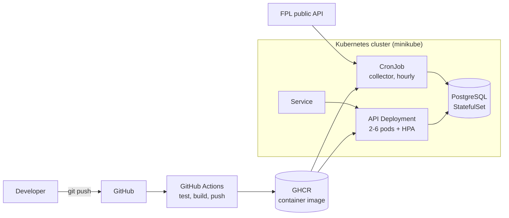

# FPL Radar


A small data service that tracks Fantasy Premier League players over time (price, form, points, ownership) and exposes the history through a REST API.

The application is deliberately simple. The point of the project is everything **around** it: containerisation, a CI/CD pipeline, and deployment to Kubernetes with health probes, scheduled jobs and autoscaling. It is a personal learning project built to practise a complete DevOps workflow end to end.

> Data comes from the unofficial public Fantasy Premier League endpoint. This project is not affiliated with the Premier League.

## Architecture



The API and the collector are built from **one image** and differ only in the start command.

## Tech stack

| Area | Tools |
|---|---|
| Application | Python 3.12, FastAPI, SQLAlchemy, PostgreSQL |
| Containers | Docker (multi-stage build), Docker Compose |
| CI/CD | GitHub Actions, GitHub Container Registry (GHCR) |
| Orchestration | Kubernetes (minikube): Deployment, Service, StatefulSet, CronJob, Secret, HPA |
| Tests | pytest |

## API

| Endpoint | Description |
|---|---|
| `GET /health` | Liveness check. Does not touch the database on purpose. |
| `GET /api/players/top?position=MID&limit=5` | Players in the best form (`GKP`, `DEF`, `MID`, `FWD`). |
| `GET /api/players/{id}/history` | Price, form and ownership of one player over time. |
| `GET /api/price-changes?hours=24` | Players whose price changed within the given window. |

Interactive docs are available at `/docs`.

## How it works

1. The **collector** (`python -m app.collector`) downloads one JSON from the FPL endpoint and stores a snapshot of every player.
2. Each run adds a new snapshot per player, so changes can be compared over time.
3. The **API** reads the newest snapshots and the history from PostgreSQL.

## Run locally

```bash
python -m venv .venv
.venv\Scripts\Activate.ps1          # Windows PowerShell
# source .venv/bin/activate         # macOS / Linux
pip install -r requirements.txt -r requirements-dev.txt

python -m pytest                    # run tests
python -m app.collector             # fetch data into a local SQLite file
uvicorn app.main:app --reload       # http://127.0.0.1:8000/docs
```

Without `DATABASE_URL` the app falls back to a local SQLite file.

## Run with Docker Compose (app + PostgreSQL)

```bash
cp .env.example .env                # then set your own password (letters and digits only)
docker compose up --build -d
docker compose run --rm collector   # fetch data into PostgreSQL
curl "http://127.0.0.1:8000/api/players/top?limit=5"
```

Data is kept on the `pgdata` volume and survives restarts. `docker compose down -v` removes it.

## CI/CD

Workflow: [`.github/workflows/ci-cd.yml`](.github/workflows/ci-cd.yml)

On every push:

1. **test**: install dependencies and run pytest on a clean runner.
2. **build-and-push** (only if tests pass): build the image with Buildx and push it to `ghcr.io/dominikfidos/fpl-radar`, tagged with the branch name, the commit SHA and `latest`.

Permissions are least-privilege: read-only by default, `packages: write` only for the push job. Authentication uses the built-in `GITHUB_TOKEN`, so no secrets are stored in the repository.

## Deploy to Kubernetes (minikube)

```bash
minikube start --driver=docker
minikube addons enable metrics-server

kubectl create secret generic fpl-db \
  --from-literal=POSTGRES_USER=portfolio \
  --from-literal=POSTGRES_PASSWORD=<PASSWORD> \
  --from-literal=POSTGRES_DB=portfolio_db \
  --from-literal=DATABASE_URL=postgresql+psycopg://portfolio:<PASSWORD>@postgres:5432/portfolio_db

kubectl apply -f k8s/postgres.yaml
kubectl rollout status statefulset/postgres
kubectl apply -f k8s/deployment.yaml -f k8s/service.yaml -f k8s/hpa.yaml -f k8s/cronjob.yaml

kubectl create job --from=cronjob/fpl-collector fpl-collector-manual   # run the collector now
kubectl port-forward svc/fpl-radar 8080:80                             # http://127.0.0.1:8080/docs
```

The container image must be public in GHCR, otherwise pods cannot pull it without an image pull secret.

| Manifest | Purpose |
|---|---|
| `deployment.yaml` | 2 replicas, rolling updates with zero unavailable pods, readiness and liveness probes on `/health`, resource requests and limits, non-root user |
| `service.yaml` | Stable in-cluster address that routes only to ready pods |
| `hpa.yaml` | Scales between 2 and 6 pods at 70% average CPU, with a 5-minute scale-down window |
| `postgres.yaml` | PostgreSQL as a StatefulSet with a persistent volume |
| `cronjob.yaml` | Hourly collector run, no overlapping runs, limited retries |

### Autoscaling demo

```bash
kubectl get hpa -w
kubectl run load1 --rm -i --tty --image=busybox:1.36 --restart=Never -- \
  /bin/sh -c "while true; do wget -q -O- 'http://fpl-radar/api/players/top?limit=50' > /dev/null; done"
```

CPU rises above the 70% target and the HPA adds pods. After the load stops, pods are removed gradually.


## Design decisions

- **Multi-stage Dockerfile**: dependencies are installed in a builder stage, the runtime image contains only the finished virtual environment and the code, and runs as a non-root user.
- **Separate liveness endpoint**: `/health` does not query the database, so a database outage does not make Kubernetes restart healthy API pods.
- **One image, two roles**: the collector reuses the API image with a different command, which keeps the build simple.
- **Secrets outside Git**: database credentials live in `.env` locally and in a Kubernetes Secret in the cluster.
- **Tests as a gate**: the image is built only after tests pass.

## Known limitations and next steps

- Tables are created at application start. A proper setup would use migrations (for example Alembic), which also avoids a startup race between replicas.
- PostgreSQL runs inside the cluster for demo purposes. In production a managed database would be preferable.
- The cluster is a local minikube setup, not a production environment.
- No monitoring yet. Planned: Prometheus and Grafana dashboards for prices and API metrics.
- Image tag `latest` is used for simplicity. In production an immutable `sha-` tag should be pinned.
- The FPL endpoint is unofficial and may change without notice.
