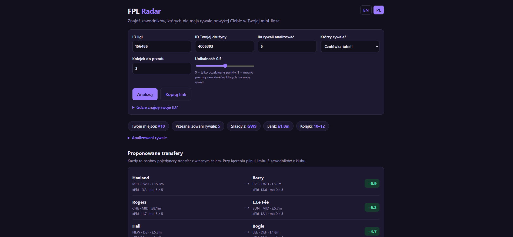
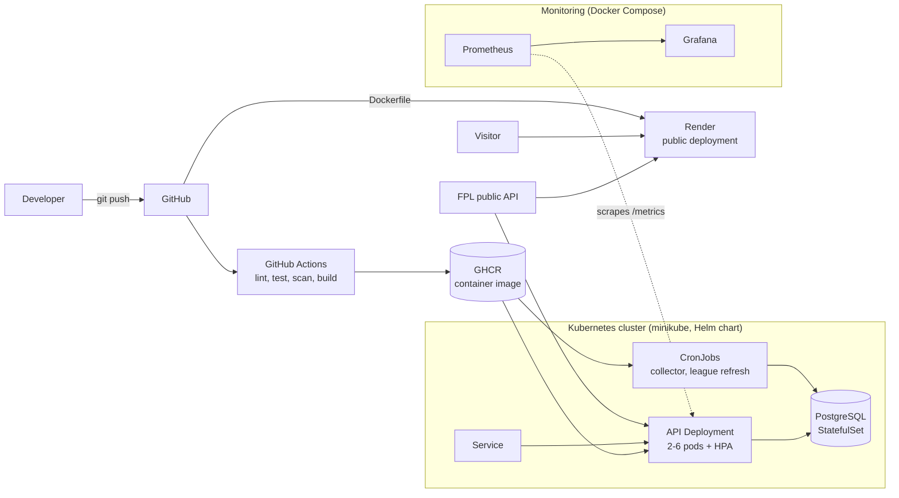
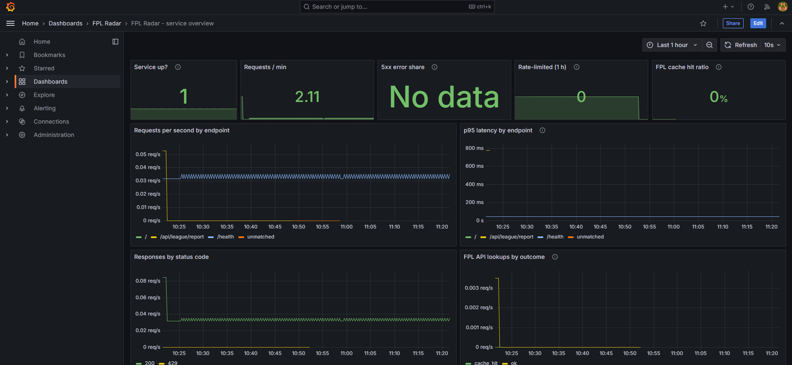
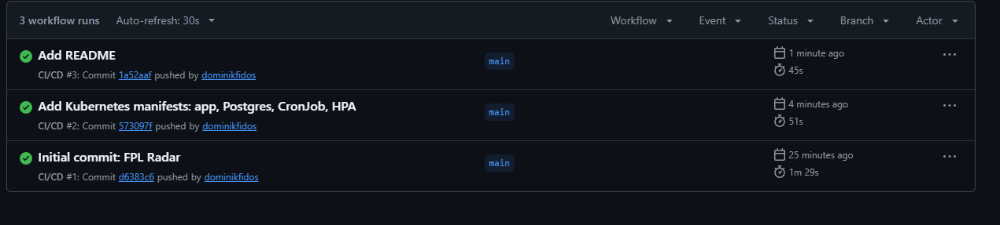
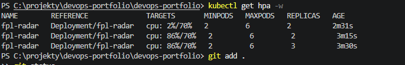

# FPL Radar


**Live demo: https://fpl-radar.onrender.com**

FPL Radar helps you catch the managers above you in a Fantasy Premier League mini-league. Enter your league ID and team ID and it shows which players your rivals do **not** own but who are expected to score well, as concrete "sell X, buy Y" suggestions. It also tracks all players over time (price, form, points, ownership) and exposes the history through a REST API.

The application is deliberately small. The point of the project is everything **around** it: containers, a CI/CD pipeline with security checks, deployment to Kubernetes (plain manifests and a Helm chart), a public deployment, and monitoring. It is a personal learning project built to practise a complete DevOps workflow end to end.

> Data comes from the unofficial public Fantasy Premier League API. This project is not affiliated with the Premier League or Fantasy Premier League. The free hosting plan sleeps when idle, so the first request after a break can take up to a minute.





## Architecture



The API, the web UI and the scheduled jobs are built from **one image** and differ only in the start command.

## Tech stack

| Area | Tools |
|---|---|
| Application | Python 3.12, FastAPI, SQLAlchemy, PostgreSQL (SQLite fallback), plain HTML/JS front end |
| Containers | Docker (multi-stage build, non-root), Docker Compose |
| CI/CD | GitHub Actions, GitHub Container Registry (GHCR), ruff, pytest + coverage, Trivy, Dependabot |
| Orchestration | Kubernetes (minikube): Deployment, Service, StatefulSet, CronJob, ConfigMap, Secret, HPA; Helm chart |
| Observability | Prometheus metrics, Grafana dashboard |
| Hosting | Render (Docker runtime, health check on `/health`) |

## Features

### League differentials

For one classic mini-league the report:

1. reads the standings and finds your rank,
2. fetches the squads of the managers above you (the top of the table, or the ones directly above you),
3. computes **local ownership**: the share of those rivals who own each player,
4. estimates expected points for the next gameweeks from xG, xA, expected goals conceded, minutes played, availability and fixture difficulty,
5. ranks players by a **League Differential Score**: `expected points x (1 - uniqueness x local ownership)`, and suggests swaps that respect position, budget (selling price plus bank), the three-players-per-club limit and availability.

The score is a transparent heuristic, not a prediction. Squads of other managers are hidden by FPL until the gameweek deadline, so the analysis uses the squads from the last deadline.

### More tabs in the web UI

The result is split into tabs (adding one is a single line in the `TABS` array in `app/static/index.html`):

- **Transfers**: the swap suggestions above, plus a **transfer planner** for 1–2 transfers made together: shared budget (bank plus what you get for the players sold), max 3 players per club, and the 4-point cost for every transfer beyond your free ones (`free_transfers` is an input, because FPL does not expose it without logging in). Each plan gets two separate verdicts: worth it in expected *points*, and worth it as a *differential* (League Differential Score).
- **Captain**: expected points in the next gameweek, reduced when many rivals captain the same player. Shows a safe pick, a differential pick and other options.
- **Rivals**: captains, chips used and recent transfers of the managers above you, and who they are buying and selling most.
- **Fixtures**: the next fixtures of your clubs with difficulty colours, and blank / double gameweeks.
- **Prices**: an *estimate* of who may rise or fall in price, from this gameweek's net transfers. FPL does not publish its formula, so the limits are rough guesses.
- **History** and **Model**: see below.
- **Live table** (a side panel next to the tabs, refreshed every minute): the league table of the running gameweek from the players' live points, the captain multiplier and transfer costs. Automatic substitutions are not applied until FPL confirms them.

### League rank history

FPL only shows the current league table, but every manager's own history is public. The **History** tab rebuilds the table after each finished gameweek (rank = how many managers had more points), stores it in the `rank_history` table and draws a rank chart with you highlighted. Once stored, showing the chart needs no FPL requests, and `python -m app.league.refresh` keeps it up to date. Ranks are counted among the tracked managers (top 25 plus you).

### Model backtest

The **Model** tab replays the finished gameweeks: for each one the expected-points model predicts using only the weeks before it (no peeking), and the result is compared with the points players really scored and with a naive baseline (average points per week so far). It reports correlation, average error and the real points of the model's top 10, and tries other values of `PRIOR_MINUTES` and the fixture-difficulty step. The finished gameweeks are cached, so only the first run is slow.

### Player history

The **collector** (`python -m app.collector`) downloads one JSON from the FPL API and stores a snapshot of every player. Each run adds a new snapshot, so price and form changes can be compared over time.

## API

| Endpoint | Description |
|---|---|
| `GET /` | Web UI for the league report. |
| `GET /api/league/report?league_id=…&entry_id=…` | League differential report (JSON). Optional: `rivals`, `mode` (`top` or `above`), `horizon`, `top`, `uniqueness`, `free_transfers`. Also contains the captain options, fixture ticker, transfer planner and price watch. Rate limited. |
| `GET /api/league/history?league_id=…&entry_id=…` | League rank after every finished gameweek (rebuilt from public data, stored in the database). Optional: `show`. Rate limited. |
| `GET /api/league/backtest` | Backtest of the expected-points model on finished gameweeks (no ids needed). Rate limited. |
| `GET /api/league/live?league_id=…&entry_id=…` | Live league table of the running gameweek (top 20 plus you). Optional: `limit`. Rate limited. |
| `GET /api/league/rivals?league_id=…&entry_id=…` | Captains, chips and recent transfers of the rivals above you. Optional: `rivals`, `mode`, `recent`. Rate limited. |
| `GET /health` | Liveness check. Does not touch the database on purpose. |
| `GET /metrics` | Prometheus metrics. Optionally protected with a bearer token (`METRICS_TOKEN`). |
| `GET /api/players/top?position=MID&limit=5` | Players in the best form (`GKP`, `DEF`, `MID`, `FWD`). |
| `GET /api/players/{id}/history` | Price, form and ownership of one player over time. |
| `GET /api/price-changes?hours=24` | Players whose price changed within the given window. |

Interactive docs are available at `/docs`.

## Run locally

```bash
python -m venv .venv
.venv\Scripts\Activate.ps1          # Windows PowerShell
# source .venv/bin/activate         # macOS / Linux
pip install -r requirements.txt -r requirements-dev.txt

python -m pytest                    # run tests
ruff check .                        # lint
uvicorn app.main:app --reload       # http://127.0.0.1:8000/
```

Without `DATABASE_URL` the app falls back to a local SQLite file.

### Database migrations (Alembic)

The schema is versioned with [Alembic](https://alembic.sqlalchemy.org/) (`migrations/`). The API, the collector and the league refresh apply pending migrations when they start (`app/migrate.py`), so a fresh database just works. You can also run them by hand:

```bash
alembic upgrade head                      # apply all migrations
alembic current                           # which version is the database at?
alembic upgrade head --sql                # print the SQL instead of running it
alembic revision -m "describe the change" # write a new migration, then edit it
```

The first migration (`0001`) is a *baseline*: it creates the original tables only when they are missing, so a database made before Alembic existed is adopted without touching its data. Tests check that the migrations build exactly the schema the models describe. `SKIP_MIGRATIONS=1` turns the automatic run off.

## Run with Docker Compose (app + PostgreSQL)

```bash
cp .env.example .env                # then set your own password (letters and digits only)
docker compose up --build -d
docker compose run --rm collector       # fetch player data into PostgreSQL
docker compose run --rm league-refresh  # build the league report once (needs FPL_LEAGUE_ID and FPL_ENTRY_ID in .env)
```

Open http://127.0.0.1:8000/. Data is kept on the `pgdata` volume and survives restarts. `docker compose down -v` removes it.

## Monitoring

The API exposes Prometheus metrics at `/metrics`: request rate and latency per endpoint, 5xx share, FPL API lookups by outcome (cache hit, fetched, failed) and rate-limit rejections. A Grafana dashboard is provisioned automatically.

```bash
docker compose --profile monitoring up --build -d
```

Grafana: http://127.0.0.1:3000 (login `admin` / `admin`, change it for anything but local use). Prometheus: http://127.0.0.1:9090. Both ports are bound to `127.0.0.1` only. When the app is public, set `METRICS_TOKEN` so that `/metrics` requires a bearer token.





## CI/CD

Workflow: [`.github/workflows/ci-cd.yml`](.github/workflows/ci-cd.yml)

| Job | What it does |
|---|---|
| **lint** | `ruff check` on the code and `helm lint` on the chart. |
| **test** | Installs dependencies and runs pytest with a coverage report on a clean runner. |
| **build-scan-push** | Builds the image on the runner, scans it with **Trivy** (a fixable HIGH or CRITICAL vulnerability fails the pipeline), and only on `main` pushes it to `ghcr.io/dominikfidos/fpl-radar` tagged with the branch name, the commit SHA and `latest`. |

Security and hygiene:

- Least-privilege permissions: read-only by default, `packages: write` only for the push job. Authentication uses the built-in `GITHUB_TOKEN`, so no secrets are stored in the repository.
- Third-party actions are **pinned to commit SHAs**, not tags, because tags can be moved. Trivy runs from its official image in a known-good version instead of a third-party action, after the March 2026 compromise of the Trivy GitHub Action ([advisory](https://github.com/aquasecurity/trivy/security/advisories/GHSA-69fq-xp46-6x23)).
- Dependabot opens weekly pull requests for Python packages, the base image and GitHub Actions.
- The pipeline has already paid off: Trivy caught three HIGH vulnerabilities in a transitive dependency (Starlette), which were fixed by updating FastAPI.

## Deploy to Kubernetes (minikube)

```bash
minikube start --driver=docker
minikube addons enable metrics-server

kubectl create secret generic fpl-db \
  --from-literal=POSTGRES_USER=portfolio \
  --from-literal=POSTGRES_PASSWORD=<PASSWORD> \
  --from-literal=POSTGRES_DB=portfolio_db \
  --from-literal=DATABASE_URL=postgresql+psycopg://portfolio:<PASSWORD>@postgres:5432/portfolio_db

kubectl apply -f k8s/postgres.yaml
kubectl rollout status statefulset/postgres
```

Then deploy the application either with plain manifests or with the Helm chart.

### Option 1: plain manifests

```bash
# put your ids into k8s/configmap.yaml first
kubectl apply -f k8s/configmap.yaml -f k8s/deployment.yaml -f k8s/service.yaml -f k8s/hpa.yaml \
              -f k8s/cronjob.yaml -f k8s/cronjob-league.yaml
```

| Manifest | Purpose |
|---|---|
| `deployment.yaml` | 2 replicas, rolling updates with zero unavailable pods, readiness and liveness probes on `/health`, resource requests and limits, non-root user |
| `service.yaml` | Stable in-cluster address that routes only to ready pods |
| `hpa.yaml` | Scales between 2 and 6 pods at 70% average CPU, with a 5-minute scale-down window |
| `postgres.yaml` | PostgreSQL as a StatefulSet with a persistent volume |
| `configmap.yaml` | Non-secret settings (league and team id) |
| `cronjob.yaml` | Hourly collector run, no overlapping runs, limited retries |
| `cronjob-league.yaml` | Daily league report refresh |

### Option 2: Helm chart

```bash
helm lint charts/fpl-radar -f charts/fpl-radar/values-minikube.yaml
helm install fpl-radar charts/fpl-radar -f charts/fpl-radar/values-minikube.yaml
helm upgrade fpl-radar charts/fpl-radar -f charts/fpl-radar/values-minikube.yaml --set autoscaling.maxReplicas=4
helm history fpl-radar
helm rollback fpl-radar 1
```

The chart templates the same objects as the manifests above. Settings live in `values.yaml`, per-environment overrides in `values-*.yaml`, and the database password stays in the `fpl-db` Secret outside Git. A checksum annotation on the pods restarts them when the ConfigMap changes.

Then:

```bash
kubectl create job --from=cronjob/fpl-radar-league-refresh league-manual   # with plain manifests: cronjob/fpl-league-refresh
kubectl port-forward svc/fpl-radar 8080:80                                 # http://127.0.0.1:8080/
```

The container image must be public in GHCR, otherwise pods cannot pull it without an image pull secret.

### Autoscaling demo

```bash
kubectl get hpa -w
kubectl run load1 --rm -i --tty --image=busybox:1.36 --restart=Never -- \
  /bin/sh -c "while true; do wget -q -O- 'http://fpl-radar/api/players/top?limit=50' > /dev/null; done"
```

CPU rises above the 70% target and the HPA adds pods. After the load stops, pods are removed gradually.




## Public deployment

The same Dockerfile is deployed on Render as a web service (free plan, SQLite instead of PostgreSQL because the database only holds a cache, `PORT=8000`, health check path `/health`). Because the service is public it has a per-client **rate limiter** (default 15 requests per minute for the report endpoint, `RATE_LIMIT_PER_MINUTE`) and caches FPL responses, so one visitor cannot make the server hammer the unofficial FPL API.

## Design decisions

- **Multi-stage Dockerfile**: dependencies are installed in a builder stage, the runtime image contains only the finished virtual environment and the code, and runs as a non-root user.
- **Separate liveness endpoint**: `/health` does not query the database, so a database outage does not make Kubernetes restart healthy API pods.
- **One image, several roles**: the API, the collector and the league refresh reuse the same image with different commands.
- **Pure analysis code**: the scoring logic has no network or database access, so it is tested in isolation with fake data. The HTTP client is tested with a mock transport (retries, backoff, pagination, cache).
- **Cache in the existing database instead of Redis**: for a few dozen requests per gameweek, one component less to run. Redis would be a natural upgrade for a shared rate limiter.
- **Safe rendering**: team and manager names come from strangers, so the front end builds the page with `textContent` and never injects them as HTML.
- **Low-cardinality metrics**: request metrics are labelled with the route template (`/api/players/{player_id}/history`), not the real URL, so the number of time series stays small.
- **No look-ahead in the backtest**: a gameweek is predicted only from the weeks before it, and the model is compared with a naive baseline, so "it works" is something that can be measured and can fail.
- **Public data instead of storing everything forever**: the rank history is rebuilt from managers' public histories and then stored, so the chart is complete even for gameweeks played before the app was first used.
- **Tabs load their own data**: the Live, Rivals, History and Model views have their own endpoints and caches (live data is cached for about a minute, finished gameweeks for days), so one slow or heavy view does not slow down the main report.
- **Secrets outside Git**: database credentials live in `.env` locally and in a Kubernetes Secret in the cluster.
- **Gates before publishing**: the image is built and scanned after lint and tests, and pushed only from `main`.

## Known limitations and next steps

- The rate limiter keeps its counters in memory, so with several replicas the limit applies per pod. A shared limiter would need Redis.
- Migrations run when each process starts. With several API replicas starting at the same moment two of them could race to create the same table (one would fail and be restarted). For a larger setup, run `alembic upgrade head` once as a Kubernetes Job or Helm pre-upgrade hook instead.
- PostgreSQL runs inside the cluster for demo purposes. In production a managed database would be preferable.
- The cluster is a local minikube setup, not a production environment, and Render's free plan sleeps when idle.
- Expected points ignore bonus points, saves and penalties (the backtest shows the model predicts about half a point too low on average, which shifts all players alike). Squads of other managers are as of the last deadline.
- The transfer planner uses market prices, not your real selling prices (FPL keeps part of the profit), and does not know how many free transfers you have unless you enter it.
- Image tag `latest` is used for simplicity. In production an immutable `sha-` tag should be pinned.
- The FPL API is unofficial and may change or block requests without notice.
- The rank history is rebuilt from the top 25 managers only, so in a very large league the places are relative to that group.
- The backtest is run on only the gameweeks played so far and does not know about past injuries, so treat small differences as noise. `BENCH_WEIGHT` and the captain factor cannot be tested with it.
- Ideas: Terraform for the infrastructure.
